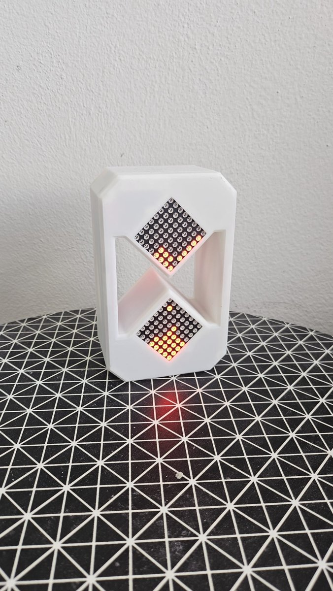
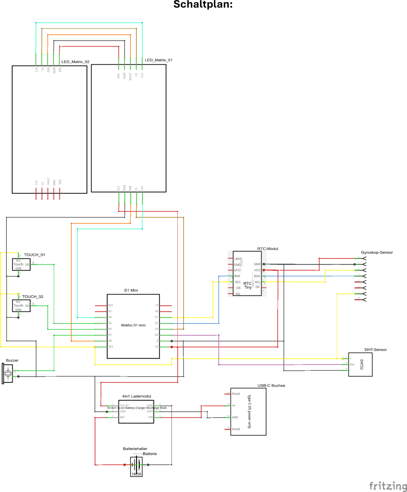

  

# TimeFlow – die digitale Sanduhr

> **TimeFlow – ein Projekt des Science Club der HTL1 Lastenstraße Klagenfurt.**
> Nachbau erlaubt, mit Namensnennung: siehe [ATTRIBUTION.md](../ATTRIBUTION.md). · 🌐 [Projekt-Website](https://htl1-klagenfurt.github.io/SCC/timeflow/)

TimeFlow ist eine Sanduhr ohne Sand. Zwei LED-Matrizen zeigen die Körner, ein Lagesensor erkennt, wie die Uhr gehalten wird, und die Körner „rieseln“ immer nach unten. Dazu kommen eine Uhr mit Wecker, eine Temperatur- und Feuchteanzeige und versteckte Easter Eggs. Akku, Ladeelektronik und Mikrocontroller sitzen in einem 3D-gedruckten Gehäuse.

TimeFlow ist als **Bausatz** gedacht: einfach genug, dass Mittelschülerinnen und Mittelschüler ihn in einem Workshop unter Anleitung zusammenbauen können.

## Downloads

| | Datei |
|---|---|
| 📘 Aufbauanleitung | [TimeFlow_Aufbauanleitung.pdf](anleitungen/TimeFlow_Aufbauanleitung.pdf) |
| 📗 Bedienungsanleitung | [TimeFlow_Bedienungsanleitung.pdf](anleitungen/TimeFlow_Bedienungsanleitung.pdf) |
| 📋 Packungsliste | [TimeFlow_Packungsliste.pdf](anleitungen/TimeFlow_Packungsliste.pdf) |
| 💾 Firmware | [firmware/SCC_Sanduhr_Main_Code_02](firmware/SCC_Sanduhr_Main_Code_02/) |
| 🖨️ 3D-Druckdateien (3MF) | [druckdateien/](druckdateien/) |
| 📐 CAD (STEP) | [cad/](cad/) |
| 🔌 Schaltplan (Fritzing) | [fritzing/Digitale_Sanduhr_03.fzz](fritzing/Digitale_Sanduhr_03.fzz) |

---

## 1. Die vier Modi

TimeFlow wechselt den Modus über die Lage: Gerät drehen, kurz auf eine der beiden Touch-Tasten tippen.

| Lage | Modus | Funktion |
|---|---|---|
| aufrecht | **Sanduhr** | Sand fällt mit der Schwerkraft. Laufzeit in Stunden, Minuten, Sekunden einstellbar |
| 90° nach links | **Uhr & Wecker** | Uhrzeit über die Echtzeituhr, Weckfunktion mit Piepton |
| 90° nach rechts | **Info** | wechselt zwischen Temperatur (°C) und Luftfeuchtigkeit (%) |
| auf dem Rücken | **Easter Egg** | Animationen (Schütteln = nächste) und Labyrinth-Spiel bis 64×64 Felder |

Alle Details zu Tasten und Menüs stehen in der [Bedienungsanleitung](anleitungen/TimeFlow_Bedienungsanleitung.pdf).

## 2. Bauteile

Pro Sanduhr (vollständig in der [Packungsliste](anleitungen/TimeFlow_Packungsliste.pdf)):

| Anzahl | Bauteil |
|---|---|
| 1 | Mikrocontroller **D1 mini** (ESP8266) |
| 2 | **LED-Matrix 8×8** mit MAX7219, rot |
| 1 | Lagesensor **MPU-6050** |
| 1 | Echtzeituhr **DS1307** mit Knopfzelle LIR2032 |
| 1 | Temperatur- und Feuchtesensor **DHT22** |
| 2 | Kapazitive **Touch-Taste** (TTP223) |
| 1 | Passiver **Buzzer** auf Lochrasterplatine |
| 1 | **Li-Ion-Akku 14500** (AA-Format, 3,7 V) mit Halter |
| 1 | **4in1-Lademodul** für 3,7-V-Li-Ion (Laden + 5 V) |
| 1 | **USB-C-Buchse** (nur Strom) |
| 2 / 7 / 2 | M3 Gewindeeinsätze / M3×5 / M3×40 Schrauben |

> ⚠️ **Akku-Sicherheit:** Nur Akkus mit Schutzschaltung und das passende Lademodul verwenden. Akku nie kurzschließen, nicht quetschen und nicht unbeaufsichtigt laden.

## 3. Gehäuse drucken

Druckfertige Dateien im Ordner [`druckdateien/`](druckdateien/):

| Datei | Inhalt |
|---|---|
| `01_Frontplatte.3mf` | Frontplatte mit Matrix-Halterung |
| `02_Wand.3mf` | Seitenwand (mit und ohne Namensfeld) |
| `03_Rueckwand_Deckel.3mf` | Rückwand / Deckel |
| `04_Kleinteile.3mf` | Akkuhalterung, Matrix-Klemmen, Uhrmodul-Halterung |
| `06_Gesamter_Timeflow.3mf` | alle Teile auf einen Blick |

Die Einzelteile als STEP liegen in [`cad/`](cad/). Ins Namensfeld kommt ein eigenes Namensschild. Der Schriftzug „HTL1 Lastenstraße“ bleibt laut [ATTRIBUTION.md](../ATTRIBUTION.md) erhalten.

## 4. Elektronik

| Bauteil | Pin | D1 mini |
|---|---|---|
| LED-Matrix (Kette aus 2) | DIN / CS / CLK | **D8** / **D3** / **D0** |
| Touch-Taste 1 / 2 | I/O | **D5** / **D6** |
| DHT22 | Data | **D4** |
| Buzzer | Signal | **D7** |
| MPU-6050 und DS1307 (I²C) | SCL / SDA | **D1** / **D2** |
| MPU-6050 | AD0 | 3V3 (Adresse 0x69) |
| Lademodul | OUT 5V / GND | 5V / G |

Versorgung: Matrizen, Echtzeituhr und Lagesensor an 5 V, Touch-Tasten und DHT22 an 3,3 V. Die Schritt-für-Schritt-Verkabelung mit Kabellängen und Farben steht in der [Aufbauanleitung](anleitungen/TimeFlow_Aufbauanleitung.pdf).

**Tipp:** Zuerst alles auf dem Steckbrett testen, erst dann ins Gehäuse einbauen.

## 5. Firmware

Code und Installation: [firmware/README.md](firmware/README.md)

## 6. Zusammenbau (Kurzfassung)

1. Buzzer auf die Lochrasterplatine löten und die Verteiler-Kabel für GND, 5 V und 3,3 V vorbereiten.
2. Stiftleisten an D1 mini, Matrizen und Touch-Tasten löten.
3. Matrizen verbinden (OUT → IN), einsetzen und mit den Klemmen fixieren.
4. Akkuhalter und Echtzeituhr über den Matrizen montieren.
5. Alle Module nach der Tabelle oben verkabeln, Lademodul und USB-C anlöten.
6. Knopfzelle und Akku einsetzen, **Firmware hochladen und testen**.
7. Namensschild einsetzen, Deckel aufsetzen und verschrauben.

---

  
  &nbsp;&nbsp;&nbsp;
   
  TimeFlow – ein Projekt des Science Club der <a href="https://htl1-klagenfurt.at">HTL1 Lastenstraße Klagenfurt</a> · Lizenz <a href="../LICENSE.md">CC BY-NC-SA 4.0</a>

