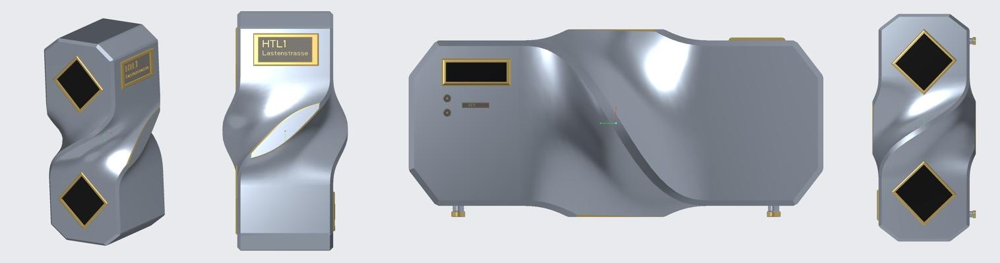
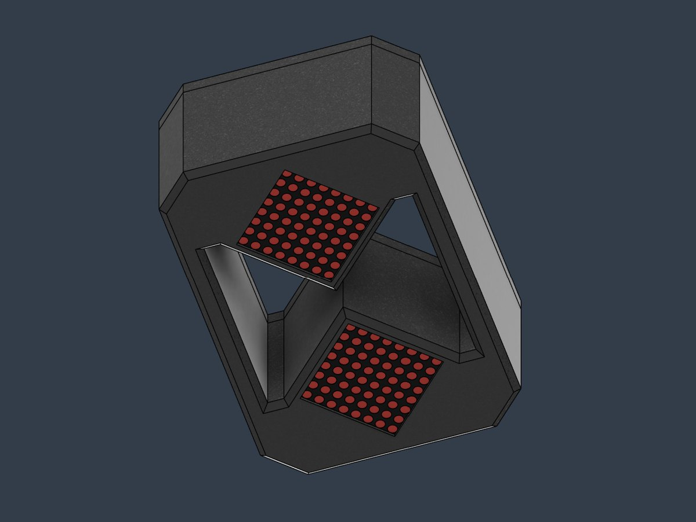

<p align="center">
  
</p>

# TimeFlow – die digitale Sanduhr

> **TimeFlow – ein Projekt des Science Club der HTL1 Lastenstraße Klagenfurt.**
> Nachbau erlaubt, mit Namensnennung: siehe [ATTRIBUTION.md](../ATTRIBUTION.md). · 🌐 [Projekt-Website](https://htl1-klagenfurt.github.io/SCC/timeflow/)

TimeFlow ist eine Sanduhr ohne Sand. Zwei LED-Matrizen zeigen die Körner, ein Lagesensor erkennt, wie die Uhr gehalten wird, und die Körner „rieseln“ immer nach unten. Dreht man die Uhr um, läuft die Zeit von vorne. Akku, Ladeelektronik und Mikrocontroller sitzen in einem 3D-gedruckten Gehäuse.

Das Projekt ist als **Bausatz** gedacht: einfach genug, dass Mittelschülerinnen und Mittelschüler ihn in einem Workshop unter Anleitung zusammenbauen können, und vielseitig genug, um weiterzuentwickeln. Als Eieruhr, Lern-Timer, Spieluhr oder für eigene Ideen.

---

## Inhalt

1. [So funktioniert es](#1-so-funktioniert-es)
2. [Bauteile](#2-bauteile)
3. [Gehäuse drucken](#3-gehäuse-drucken)
4. [Elektronik aufbauen](#4-elektronik-aufbauen)
5. [Software](#5-software)
6. [Zusammenbau](#6-zusammenbau)
7. [Ideen zum Weiterentwickeln](#7-ideen-zum-weiterentwickeln)

---

## 1. So funktioniert es

```
          ┌──────────────┐
          │  Lagesensor  │  MPU-6050: wo ist „unten“?
          └──────┬───────┘
                 │ I²C
┌────────┐   ┌───┴───────────┐   SPI   ┌───────────────┐
│  Akku  ├──►│ Mikrocontroller├───────►│ LED-Matrix oben│  8×8
│ + Lade-│   │  (ESP8266)    │         ├───────────────┤
│ modul  │   └───┬───────────┘         │LED-Matrix unten│  8×8
└───▲────┘       │                     └───────────────┘
    │        Touch-Taster
  USB-C      (Start / Modus)
```

- **Zwei 8×8-LED-Matrizen** stehen um 45° gedreht übereinander, Ecke an Ecke. Wo sich die Ecken berühren, ist der „Hals“ der Sanduhr.
- Jede leuchtende LED ist ein **Sandkorn**. Ein Korn fällt nach unten, wenn das Feld darunter frei ist, sonst rutscht es schräg nach links oder rechts. So entstehen ganz von selbst Sandhaufen.
- Der **Lagesensor** misst die Schwerkraft. Daraus berechnet das Programm, wo gerade „unten“ ist. Liegt die Uhr schräg, rieselt der Sand schräg.
- Durch den Hals darf in festen Abständen **nur ein Korn** von oben nach unten wandern. Aus der Anzahl der Körner und dem Abstand ergibt sich die Laufzeit. Bei 60 Körnern und einer Sekunde Abstand ist das eine Minute.

## 2. Bauteile

Pro Sanduhr:

| Anzahl | Bauteil | Hinweis |
|---|---|---|
| 1 | Mikrocontroller **Wemos D1 mini** (ESP8266) oder kompatibel | per USB programmierbar |
| 2 | **LED-Matrix 8×8 mit MAX7219**-Treiber | in Reihe geschaltet (Daisy Chain) |
| 1 | **Lagesensor MPU-6050** (Beschleunigung + Gyroskop) | I²C |
| 1 | **Li-Ion/LiPo-Akku 3,7 V**, 500–1800 mAh | Größe nach Platz im Gehäuse |
| 1 | **Lade- und Spannungsmodul** für 1-Zellen-Li-Ion (Laden + 5 V Ausgang) | mit Schutzschaltung |
| 1 | **Kapazitiver Touch-Taster** | Start, Zeit wählen |
| 1 | **USB-C-Buchse** | zum Laden |
| 1 | Schiebeschalter (Ein/Aus) | optional |
| – | Lochrasterplatine, Litze, Stiftleisten, Schrauben | |

Optional für eigene Erweiterungen: Echtzeituhr (DS1307), Temperatur- und Feuchtesensor (DHT22), RGB-Matrizen statt roter.

> ⚠️ **Akku-Sicherheit:** Nur Akkus mit Schutzschaltung und ein passendes Lademodul verwenden. Den Akku nie kurzschließen, nicht quetschen und nicht unbeaufsichtigt laden.

## 3. Gehäuse drucken

Die CAD-Dateien liegen im STEP-Format im Ordner [`cad/`](cad/). Sie lassen sich in jedem gängigen CAD- oder Slicer-Programm öffnen.

| Teil | Datei | Anzahl |
|---|---|---|
| Wand mit Namensfeld | [`wand_mit_namensfeld.step`](cad/wand_mit_namensfeld.step) | 1 |
| Wand ohne Namensfeld (Alternative) | [`wand_ohne_namensfeld.step`](cad/wand_ohne_namensfeld.step) | – |
| Deckel | [`deckel.step`](cad/deckel.step) | 1 |
| Halterung LED-Matrizen | [`led_matrix_halterung.step`](cad/led_matrix_halterung.step) | 1 |
| Klemme für Matrix | [`matrix_klemme.step`](cad/matrix_klemme.step) | 2 |
| Halterung Akku | [`batterie_halterung.step`](cad/batterie_halterung.step) | 1 |
| Halterung Uhr-/Controller-Modul | [`uhr_modul_halterung.step`](cad/uhr_modul_halterung.step) | 1 |

**Druck-Empfehlung:** PLA oder PETG, 0,2 mm Schichthöhe, 15–20 % Füllung. Die großen Gehäuseteile flach auf die größte Fläche legen, Stützstrukturen nur bei Überhängen über 45°. Im Namensfeld ist Platz für den eigenen Namen. Das Feld mit „HTL1 Lastenstraße“ bleibt laut [ATTRIBUTION.md](../ATTRIBUTION.md) erhalten.

<p align="center">
  
</p>

## 4. Elektronik aufbauen

**Referenz-Verdrahtung** für den D1 mini. Die Pins lassen sich in der Software anpassen.

| Von | Pin | an D1 mini |
|---|---|---|
| LED-Matrix 1 | VCC / GND | 5V / G |
| | DIN | D7 (GPIO13) |
| | CLK | D5 (GPIO14) |
| | CS | D8 (GPIO15) |
| LED-Matrix 2 | DIN | an DOUT von Matrix 1 |
| | CLK, CS, VCC, GND | parallel zu Matrix 1 |
| MPU-6050 | VCC / GND | 3V3 / G |
| | SDA | D2 (GPIO4) |
| | SCL | D1 (GPIO5) |
| Touch-Taster | VCC / GND | 3V3 / G |
| | OUT / SIG | D6 (GPIO12) |
| Lademodul | Akku + / – | Akku |
| | 5 V Ausgang | 5V / G am D1 mini |
| USB-C-Buchse | VBUS / GND | Eingang Lademodul |

**Tipps**

- Zuerst alles auf dem **Steckbrett** testen, erst dann auf der Lochrasterplatine löten.
- Die LED-Matrizen ziehen bei voller Helligkeit den meisten Strom. Eine niedrige Helligkeitsstufe spart Akku und reicht in Innenräumen völlig.
- Kurze Kabel verwenden und alle Masseleitungen (GND) gemeinsam verbinden.

## 5. Software

Programmiert wird mit der **Arduino IDE** und der ESP8266-Boardunterstützung. Aufbau und Ablauf beschreibt [firmware/README.md](firmware/README.md).

## 6. Zusammenbau

1. LED-Matrizen in die Halterung setzen und mit den beiden Klemmen fixieren.
2. Lagesensor **fest** und gerade montieren. Er bestimmt, wo „unten“ ist.
3. Akku in die Akkuhalterung legen, Lademodul und USB-C-Buchse so platzieren, dass die Buchse von außen erreichbar ist.
4. Mikrocontroller in die Modulhalterung setzen, alles verdrahten und **vor dem Schließen testen**: Uhr kippen, Sand muss mitrieseln.
5. Wand und Deckel aufsetzen und verschrauben.
6. Namensfeld beschriften, fertig.

## 7. Ideen zum Weiterentwickeln

- **Schüttelfunktion:** Uhr schütteln setzt die Zeit zurück.
- **Zeit wählen** per Touch: 1, 3, 5 oder 10 Minuten.
- **Spielmodus:** Würfel, Reaktionsspiel, „heißer Draht“ mit Lagesensor.
- **Echtzeituhr** als Tischuhr mit Sanduhr-Animation.
- **WLAN:** Der ESP8266 kann die Laufzeit per Handy einstellen.
- **Eigenes Gehäuse** designen, dabei an das HTL1-Namensfeld denken.

---

<p align="center">
  
  &nbsp;&nbsp;&nbsp;
  <br>
  <sub>TimeFlow – ein Projekt des Science Club der <a href="https://htl1-klagenfurt.at">HTL1 Lastenstraße Klagenfurt</a> · Lizenz <a href="../LICENSE.md">CC BY-NC-SA 4.0</a></sub>
</p>
